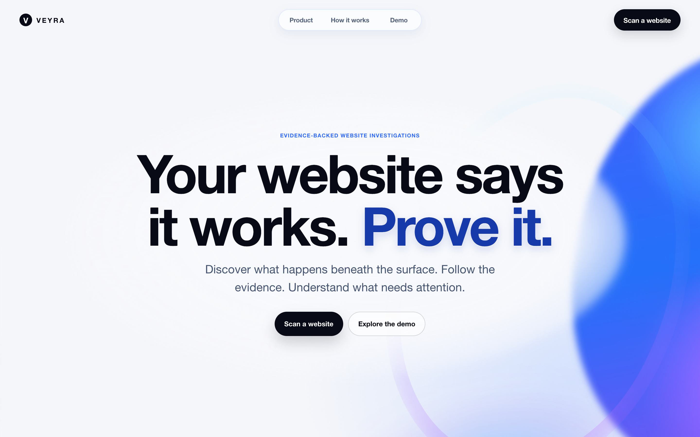
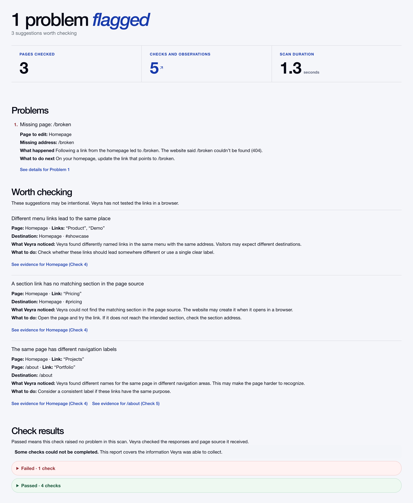
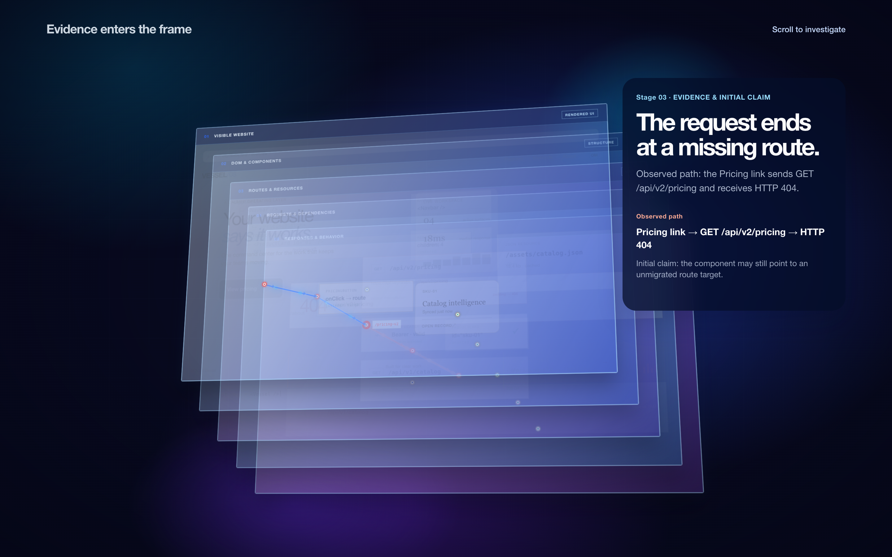

# Veyra

**An independent, evidence-first QA engineer for your website.**

[**Try Live Demo →**](https://veyra-4mu5.onrender.com/)



## What Veyra does

Veyra helps website owners and developers understand what needs attention, why it matters, and what to do next.

- **Problems** — Find broken links, missing pages, and observed redirect failures.
- **Worth checking** *(V1.1 preview)* — Spot redundant navigation, missing section targets, and inconsistent link labels without treating intentional repetition as a bug.
- **Evidence traceability** — Follow each finding back to the recorded page and supporting check.
- **Repeat scans** — See whether an observed problem has been fixed after making changes.

## Inside a report



*The report explains what happened, which page to edit, and what to do next. Screenshot: locally verified V1.1 with controlled example data. The public demo currently runs V1.*

## How to use it

1. Paste a public website address — no `https://` needed.
2. Review the **Problems** in plain English. V1.1 also separates suggestions under **Worth checking**.
3. Make a change, then select **Scan again** to compare the results.

## Under the surface



The interactive showcase illustrates how evidence can explain a website problem. It uses example data, not a live browser investigation.

## Quick start

Requires Node.js 24 and pnpm 11.19.0.

```sh
pnpm install --frozen-lockfile
pnpm dev
```

Open [localhost:3000](http://localhost:3000).

## Engineering highlights

| Area | Implementation |
| --- | --- |
| Frontend | Next.js, React, TypeScript |
| Scanner | Deterministic, read-only HTTP/HTML collection; up to 8 pages and 45 seconds |
| Reliability | URL, SSRF/egress and origin safeguards; bounded report storage |
| Quality | 826 automated checks passed for the locally verified V1.1 feature branch, including desktop and mobile Chrome/WebKit |
| Deployment | Single-instance Node service on Render |

Veyra inspects returned page source and responses. Target JavaScript, browser interactions and AI analysis are not executed. See the [scanning boundaries](docs/SECURITY.md), [architecture](docs/ARCHITECTURE.md), and [deployment guide](docs/DEPLOY_RENDER.md).

---

Made by **Om Sawkare** · Evidence over assumption.
